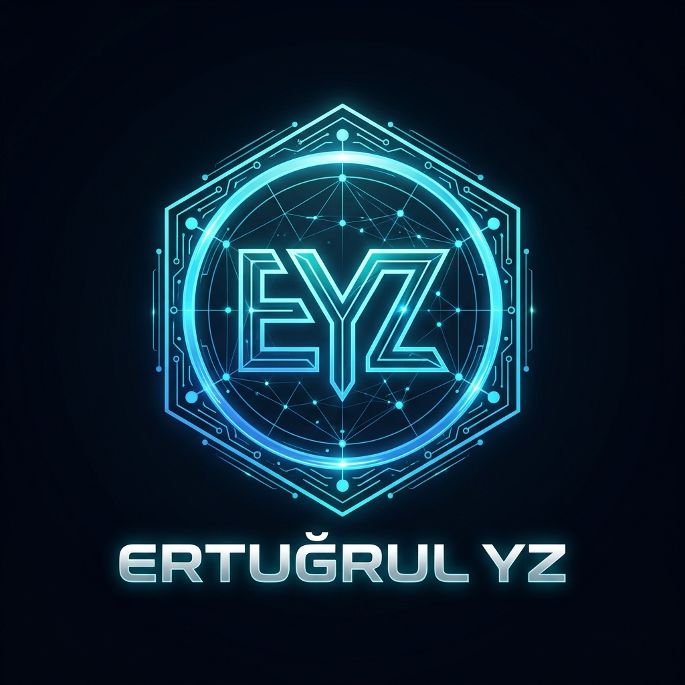

<div align="center">

# ⚽ Ertuğrul YZ — Otonom Spor & Bahis Oyunları Analiz Motoru
### 7/24 Kesintisiz Maçkolik Canlı Bülten Tarayıcısı, Wall Street Quant Modeli ve Öz-Öğrenen İddaa Robotu

[](#)
[](#)
[](#)
[](#)
[](#)



</div>

---

## 📌 Proje Genel Bakışı

**Ertuğrul YZ Bahis Oyunları ve Otonom Spor Analiz Motoru**, holdingimizin **5. Kat Spor Analiz Laboratuvarı** ile **2. Kat Finans ve Borsa Quant İlkeleri**'ni bir araya getiren kurumsal bir otonom yapay zeka sistemidir.

Sistem; sıfır duygusal önyargı ile canlı bültenleri sürekli olarak tarar, oran hareketlerini izler, Wall Street quant algoritmalarıyla (+EV Alpha) matematiksel avantajı hesaplar, dinamik Kelly Kriteri ile kasa yönetimi yapar ve **kaybettiği maçlarda kök neden otopsisi (post-mortem) gerçekleştirerek kendi karar ağırlıklarını eğitir.**

---

## 🚀 Temel Yetenekler ve Modüller

```
ErtugrulYZ-Spor-ve-Iddaa-Analiz-Motoru/
├── core/
│   ├── mackolik_harvester.py         # Canlı Maçkolik İddaa bülteni ve oran kazıyıcısı
│   ├── adaptive_learner.py           # Öz-öğrenen beyin ve hata otopsisi motoru
│   ├── quant_sports_engine.py        # Futbol RSI, Bollinger Volatilitesi, +EV ve Kelly
│   ├── risk_guardian.py              # %10 Devre Kesici (Circuit Breaker) ve telemetri
│   ├── sqlite_bankroll_manager.py    # ACID uyumlu SQLite kasa ve kupon yöneticisi
│   ├── autonomous_agent_scheduler.py # 15 dakikalık periyodik sonuçlandırma zamanlayıcısı
│   └── vps_spor_daemon.py            # 7/24 kesintisiz Linux/Windows nöbetçi motoru
├── ui/
│   ├── mackolik_robot_dashboard.html # Modern siber koyu tema canlı gösterge paneli
│   └── report_generator.py           # Görsel maç öncesi analiz raporu üreteci
├── tools/
│   ├── gunluk_ogrenme_ve_bahis.py    # Günlük otopsi ve bahis açma CLI
│   └── zamanlayici_arkaplanda_baslat.vbs # Sessiz arka plan başlatıcısı
├── container/
│   ├── Dockerfile                    # Linux VPS Docker kurulum paketi
│   ├── docker-compose.yml            # Docker Compose orkestrasyonu
│   └── systemd/                      # Linux systemd servis yapılandırması
├── data/
│   ├── autonomous_agent.db           # SQLite canlı veritabanı
│   └── agirliklar_model.json         # Kendi kendine eğitilen model ağırlıkları
└── assets/
    ├── Ertugrul_YZ_Logo.png          # Yüksek çözünürlüklü marka logosu
    └── Ertugrul_YZ_Logo.svg          # Vektörel kurumsal logo
```

---

## 🧠 Öz-Öğrenme ve Kök Neden Otopsisi (Post-Mortem Engine)

Sistem yalnızca tahmin yapmaz; **kaybettiğinde hatasından ders çıkarır**:
1. **Ev Sahibi Erken Gol Zafiyeti:** İç sahada erken gol bulan takımların direnci tespit edilip `Ev Sahibi Avantajı` katsayısı otomatik yükseltilir.
2. **Deplasman Kontra-Atak Kalitesi:** Deplasman ekiplerinin geçiş hücumu başarısı modelin `Kadro Kalitesi` ağırlığını artırır.
3. **Katsayı Adaptasyonu:** Karar ağırlıkları (`kadro_kalitesi`, `form_ve_puan`, `dinlenme`, `seyahat_cezasi`, `ev_sahibi_avantaji`) her maç bitiminde normalize edilerek güncellenir.

---

## 📈 Kantitatif Borsa & Risk Yönetimi Standartları

* **Futbol RSI (Göreceli Güç İndikatörü):** Takımların son maçlardaki galibiyet, beraberlik ve averaj ivmesini 0 - 100 arasında puanlar.
* **Bollinger Bantları & Skor Volatilitesi:** Toplam gol oynaklığına göre 2.5 Alt veya KG Var tercihlerini filtreler.
* **Beklenen Değer (+EV / Alpha):** Piyasada matematiksel iskonto sunmayan negatif beklenen değerli maçlara **0 TL pozisyon (PAS GEÇ)** emri verir.
* **Kesirli Kelly Kriteri (Fractional Kelly):** Kasadan tek maça asla %1 - %3.5 bandından fazla sermaye riske edilmez.
* **Devre Kesici (Circuit Breaker):** Günlük kasa kaybı %10 eşiğine ulaştığında sistem otomatik olarak kilitlenir.

---

## 🛠️ Hızlı Kurulum ve Çalıştırma

### 1. Bağımlılıkların Kurulması
```bash
pip install schedule beautifulsoup4 requests
```

### 2. Canlı Bülteni Tara ve Bahis Aç
```bash
python tools/gunluk_ogrenme_ve_bahis.py
```

### 3. 7/24 Zamanlayıcıyı Arka Planda Başlat
```bash
# Windows
wscript tools/zamanlayici_arkaplanda_baslat.vbs

# Linux Bulut VPS (Docker)
docker-compose -f container/docker-compose.yml up -d
```

### 4. Canlı Web Paneli
Görsel gösterge panelini doğrudan tarayıcınızda açın:
```bash
ui/mackolik_robot_dashboard.html
```

---

## 📜 Lisans ve Telif Hakkı

Bu yazılım **Ertuğrul YZ Holding** bünyesinde geliştirilmiştir. Tüm hakları saklıdır.  
Marka ve İmza: **Ertuğrul YZ**
